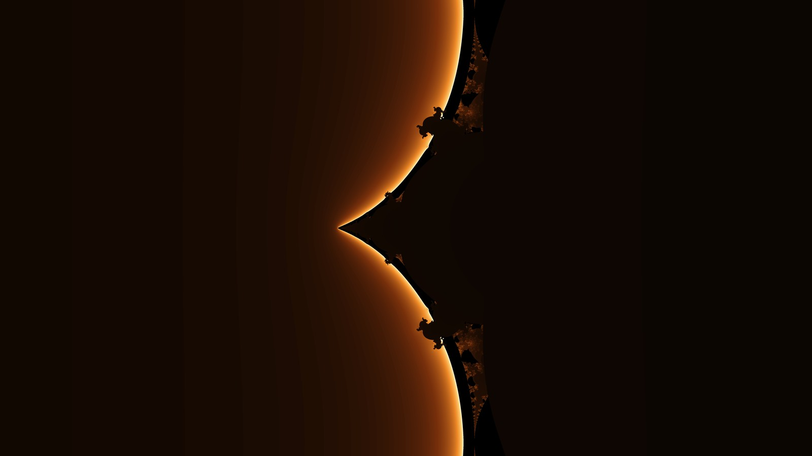
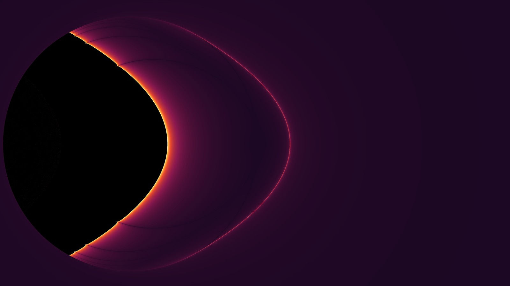

<p align="center">
  
</p>

<h1 align="center">Scale</h1>

<p align="center">
  A Windows desktop application for exploring mathematical fractals and exporting high-resolution 4K images. Built with C# and .NET 10 (WPF).
</p>

<p align="center">
  <a href="https://github.com/loyality7/Scale/releases/latest"></a>
  <a href="https://github.com/loyality7/Scale/actions/workflows/build-and-release.yml"></a>
  
  
  <a href="./LICENSE"></a>
</p>

## Screenshots

| Julia Set | Newton-Raphson |
| :---: | :---: |
|  |  |

| Rational Dynamics | Custom Equation |
| :---: | :---: |
|  |  |

| Algebraic Fractal |
| :---: |
|  |

## Features

- Real-time multi-threaded rendering using all available CPU cores.
- Custom equation parser: Enter mathematical expressions like `z^3 / (1 + z^2) + c`, `sin(z) + c`, or `bar(z)^3 + c`. Supports standard arithmetic, functions (`sin`, `cos`, `tan`, `sinh`, `cosh`, `exp`, `sqrt`, `abs`, `log`, `ln`), and complex conjugation.
- Curated presets: Includes classic Mandelbrot, Julia, Burning Ship, Newton, Tricorn, and specific coordinates from Michael Fogleman's original macOS Scale app.
- Color palettes: Multiple gradient schemes with real-time gamma contrast adjustment.
- Export: Background 4K UHD (3840x2160) image export with live progress bar and cancellation.
- Clipboard: Copy current render directly to clipboard (`Ctrl + C`) or copy exact coordinates as text (`Ctrl + Shift + C`).

## Controls

| Action | Input |
| :--- | :--- |
| Pan | Left click and drag |
| Zoom | Mouse wheel |
| Zoom in 2x | Double click |
| Zoom out 2x | Right click |
| Save 4K image | Ctrl + S |
| Copy image | Ctrl + C |
| Copy coordinates | Ctrl + Shift + C |
| Reset view | Ctrl + R or Home |
| Toggle controls panel | Ctrl + I |
| Fullscreen | F11 |
| Random equation | Space |
| Zoom in / out | + / - |
| Pan step | Arrow keys |

## Running the Application

### Option 1: Download Standalone Executable (Recommended)

Download `ScaleWindows.exe` directly from the [latest release](https://github.com/loyality7/Scale/releases/latest). It runs on 64-bit Windows without installing .NET.

### Option 2: Run with .NET SDK

Requires the .NET 10 SDK.

```powershell
git clone https://github.com/loyality7/Scale.git
cd Scale
dotnet run
```

### Option 3: Build Release

```powershell
dotnet build -c Release
```

### Option 4: Publish Standalone Executable

To produce a single, self-contained executable that runs on 64-bit Windows without needing .NET installed:

```powershell
dotnet publish -c Release -r win-x64 --self-contained true -p:PublishSingleFile=true -p:IncludeNativeLibrariesForSelfExtract=true -o ./publish
```

The output file is generated in `publish/ScaleWindows.exe`.

## Supported Equations

| Name | Type | Formula |
| :--- | :--- | :--- |
| Mandelbrot | Polynomial | z_{n+1} = z_n^p + c |
| Julia | Parameterized | z_{n+1} = z_n^p + J |
| Burning Ship | Modulus | z_{n+1} = (\|Re(z)\| + i\|Im(z)\|)^p + c |
| Newton-Raphson | Root dynamics | z_{n+1} = z_n - (z_n^p - 1) / (p * z_n^{p-1}) |
| Tricorn | Antiholomorphic | z_{n+1} = bar(z_n)^p + c |
| Transcendental Sine | Trigonometric | z_{n+1} = c * sin(z_n) |
| Custom Equation | User-defined AST | Arbitrary expression in terms of z, c, and mathematical functions |

## Author

loyality7 (https://github.com/loyality7)
